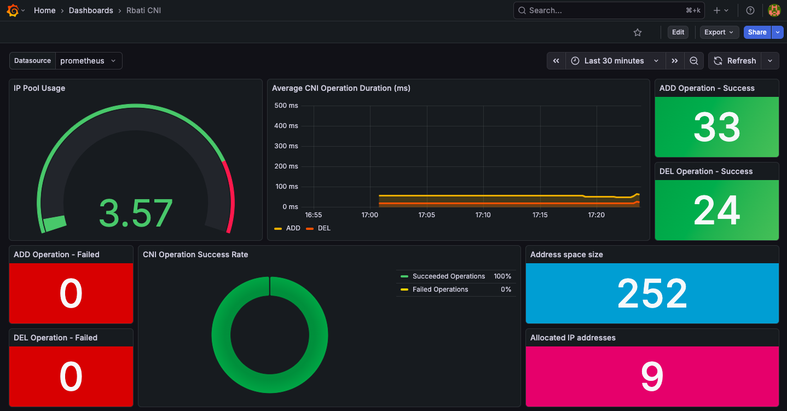
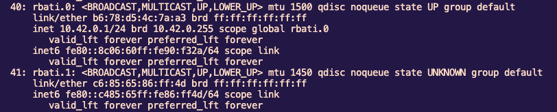
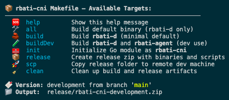

# Rbati CNI 🐉


[](https://github.com/chahid001/rbati-cni/releases/latest)
[](https://www.apache.org/licenses/LICENSE-2.0)

A simple, yet powerful Container Network Interface (CNI) for Kubernetes, built from scratch in Go. Rbati CNI provides a robust L2 overlay network using VXLAN, enabling seamless pod-to-pod communication across different nodes.

---
## ✨ Features

* **VXLAN Overlay**: Creates a scalable Layer 2 network over your existing Layer 3 infrastructure.
* **IPAM with embedded bolt DB**: Manages IP address allocation for pods securely.
* **Controller/Agent Model**: Uses Kubernetes informers to react instantly to cluster changes (new nodes, pods, etc.).
* **Built-in Monitoring**: Includes a custom Prometheus exporter and Grafana dashboard for real-time ipam/CNI metrics.
* **NAT for Internet Access**: Provides outbound internet connectivity for pods using `iptables` masquerading.
* **No External Dependencies**: Self-contained architecture; does not require etcd or Consul.

---
## 🏗️ Architecture
Rbati CNI uses a standard two-component architecture:

1.  **`agent-controller` (DaemonSet)**: A long-running process that runs on every node in the cluster.
    * Creates and manages the VXLAN and bridge interfaces.
    * Sets up `iptables` for NAT.
    * Watches the Kubernetes API for new nodes and pods to update routing and forwarding tables.

2.  **`rbati` CNI Plugin (Binary)**: A short-lived executable located in `/opt/cni/bin/`.
    * Called by the container runtime (like containerd) during pod creation (`ADD`) and deletion (`DEL`).
    * Handles IPAM, creating the veth pair for the pod, and connecting it to the CNI bridge.

```text
┌────────────────────────── Node 1 ──────────────────────────┐   ┌────────────────────────── Node 2 ──────────────────────────┐
│                                                            │   │                                                            │
│  ┌─────────┐    ┌─────────┐                                │   │                                ┌─────────┐    ┌─────────┐  │
│  │ Pod A   │    │ Pod B   │                                │   │                                │ Pod C   │    │ Pod D   │  │
│  └───┬─────┘    └───┬─────┘                                │   │                                └───┬─────┘    └───┬─────┘  │
│      │ veth         │ veth                                 │   │                                    │ veth         │ veth   │
│      └─────┬────────┘                                      │   │                                    └─────┬────────┘        │
│            │                                               │   │                                          │                 │
│      ┌─────▼─────┐                                         │   │                                    ┌─────▼─────┐           │
│      │ rbati.0   │                                         │   │                                    │ rbati.0   │           │
│      │ (Bridge)  │                                         │   │                                    │ (Bridge)  │           │
│      └─────┬─────┘                                         │   │                                    └─────┬─────┘           │
│            │                                               │   │                                          │                 │
│      ┌─────▼─────┐        Cross-Node Pod Communication     │   │     Cross-Node Pod Communication ┌─────▼─────┐           │
│      │ rbati.1   ├<═════════════════════════════════════════════════════════════════════════════>┤ rbati.1   │           │
│      │ (VXLAN)   │                                         │   │                                    │ (VXLAN)   │           │
│      └─────┬─────┘                                         │   │                                    └─────┬─────┘           │
│            │                                               │   │                                          │                 │
│      ┌─────▼─────┐                                         │   │                                    ┌─────▼─────┐           │
│      │  eth0     ├<─────────────────────────────────── Underlay Network ────────────────────────>┤  eth0     │           │
│      └───────────┘                                         │   │                                    └───────────┘           │
│                                                            │   │                                                            │
└────────────────────────────────────────────────────────────┘   └────────────────────────────────────────────────────────────┘
```

---

## 📊 Monitoring & Observability

Rbati CNI isn't just a black box; it comes with observability out of the box. The agent exposes Prometheus metrics for IPAM and CNI operations usage.


*(Screenshot: Custom Grafana dashboard showing real-time IPAM/CNI operations)*

---

## 🛠️ CLI & Interfaces

The project includes a robust Makefile and clear interface management.

**Interfaces Created:**
Rbati CNI creates a Bridge (`rbati.0`) and a VXLAN interface (`rbati.1`) on the host to manage traffic.


**Developer Tools:**
Easy-to-use Make commands for building, testing, and deploying.


---

## 🚀 Getting Started

### Prerequisites
* A Kubernetes cluster (v1.20+ recommended).
* `sudo` access on all nodes to install the CNI binary.

### Installation
The recommended way to install Rbati CNI is by using the assets from the latest GitHub Release.

1.  **Download the latest release**
    Go to the [**Releases Page**](https://github.com/chahid001/rbati-cni/releases/latest) and download the `rbati-cni.tar.gz` archive.

2.  **Install on Each Node**
    Copy the archive to each node in your cluster, extract it, and run the installation script. This will copy the CNI binary and configuration to the correct locations and apply the RBAC and DaemonSet manifests.

    ```bash
    tar -xvf rbati-cni.tar.gz
    cd rbati-cni
    # On the Control Plane / Master
    sudo ./install.sh
    ```

    ```bash
    # On Worker Nodes
    sudo ./worker.sh
    ```

Your CNI is now active! New pods will automatically use Rbati CNI for networking.

---
## 🔧 Configuration

The CNI configuration is managed via a file in `/etc/cni/net.d/`, typically named `10-rbati.conf`. The installer places a default version for you.

```json
{
  "cniVersion": "0.4.0",
  "name": "rbati",
  "type": "rbati", 
  "iface": "eth1",
  "metrics_port": "9100",
  "ipam": {           
    "dns": {
      "nameservers": ["8.8.8.8", "1.1.1.1"],
      "search": ["svc.cluster.local"]
    }
  }
}
```
**Note**: Please change `iface` to the default network interface of your system (e.g., `eth0`, `ens33`) which the VXLAN tunnel will use for cross-node communication.

---
## 🔮 Roadmap

The following features are planned for future releases:

- [ ] **Agent Monitoring**: Expanding the metrics to include agent health monitoring and VXLAN/Packets traffic. 
- [ ] **Network Policies**: Implementation of `NetworkPolicy` resource support (Ingress/Egress) using `iptables` chains.
- [ ] **eBPF Dataplane**: Replacing the current `iptables` and Bridge logic with eBPF (XDP/TC) for high-performance packet processing, similar to Cilium.

---

## 💻 Development Environment

I used K3s for my development environment. Use the following command to spin up a K3s cluster without the default Flannel CNI:

```bash
# Master node
curl -sfL https://get.k3s.io | \
  INSTALL_K3S_EXEC="\
    --bind-address=<host IP> \
    --node-ip=<host IP> \
    --flannel-backend=none \
    --disable-network-policy" \
  K3S_KUBECONFIG_MODE="644" \
  K3S_NODE_NAME=<node name> \
  sh -
```

### Build from Source
Want to contribute?

1.  **Clone the repository:**
    ```bash
    git clone https://github.com/chahid001/rbati-cni.git
    cd rbati-cni
    ```
2.  **Build the binaries:**
    ```bash
    make buildDev
    ```

---
## 📄 License
This project is licensed under the Apache License 2.0. See the [LICENSE](LICENSE) file for details.